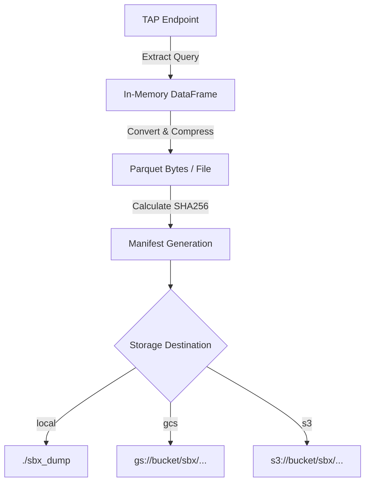

# Architecture & Technical Specification: Cloud Storage Sync for SBX Dumps

## 1. Overview
The SBX dump currently generates Parquet snapshots (`systems`, `orbits`, `velocities`, `alias`, `configurations`, `duplicates`) in a local directory (`./sbx_dump`). This document defines the technical specification for persisting and versioning these artifacts in object storage, targeting:
1. **Google Cloud Storage (GCS)** as the primary target (native and S3-interoperability modes).
2. **S3-compatible Object Storage** (AWS S3, Cloudflare R2, MinIO, or GCS S3 API) via a unified interface.

---

## 2. Storage Strategy & Architecture

### 2.1 Bucket Organization & Path Convention
To ensure snapshots are reproducible, timestamped, and discoverable, objects will follow a date-partitioned layout with a pointer to `latest`:

```text
gs://<bucket-name>/sbx/
├── latest/
│   ├── manifest.json
│   ├── systems.parquet
│   ├── orbits.parquet
│   ├── velocities.parquet
│   ├── alias.parquet
│   ├── configurations.parquet
│   └── duplicates.parquet
└── snapshots/
    └── YYYY-MM-DDTHHMMSSZ/
        ├── manifest.json
        ├── systems.parquet
        ├── orbits.parquet
        ├── velocities.parquet
        ├── alias.parquet
        ├── configurations.parquet
        └── duplicates.parquet
```

### 2.2 Metadata Manifest (`manifest.json`)
Each dump run generates and uploads a `manifest.json` containing:
- `timestamp`: UTC ISO-8601 dump completion time.
- `source_service`: `https://astro.ulb.ac.be:443/sbx/tap`
- `tables`: Map of table names to row count, byte size, and SHA256 checksum.
- `schema_version`: Version of this manifest format (e.g. `1.0.0`).

Example:
```json
{
  "version": "1.0.0",
  "timestamp": "2026-10-10T18:58:27Z",
  "endpoint": "https://astro.ulb.ac.be:443/sbx/tap",
  "tables": {
    "velocities": {
      "rows": 224148,
      "size_bytes": 2383782,
      "sha256": "e3b0c44298fc1c149afbf4c8996fb92427ae41e4649b934ca495991b7852b855"
    }
  }
}
```

---

## 3. Storage Provider Options & Interoperability

### Option A: Cloud-Agnostic FileSystem Interface (`fsspec` / `pyarrow.fs`) — **Recommended**
Using `fsspec` (`gcsfs` and `s3fs`) or PyArrow's native filesystems (`pyarrow.fs.GcsFileSystem` / `pyarrow.fs.S3FileSystem`):
- **Why**: PyArrow is already a project dependency.
- Streams parquet files directly from memory or disk without requiring heavy vendor SDK lock-in.
- Supports both `gs://` and `s3://` URIs interchangeably based on the destination URI configuration.

### Option B: Google Cloud Storage S3-Interoperability Mode
GCS provides an HMAC-based S3 XML API compatible with standard S3 clients (boto3, s3fs):
- **Endpoint**: `https://storage.googleapis.com`
- **Authentication**: HMAC Access Key + Secret (generated in GCP Console under *Cloud Storage > Settings > Interoperability*).
- **Pros**: The exact same S3 client code can be used for AWS S3, Cloudflare R2, MinIO, or GCS without changes.

### Option C: Native Google Cloud Client (`google-cloud-storage`)
- Uses Google Application Default Credentials (ADC) or service account keys (`GOOGLE_APPLICATION_CREDENTIALS`).
- Best for native GCP deployments (Cloud Run, Compute Engine, GKE).

---

## 4. Configuration & Environment Variables

All storage configuration is injected via standard environment variables or a `.env` file (supporting 12-factor design):

| Variable | Description | Default | Example |
| :--- | :--- | :--- | :--- |
| `SBX_STORAGE_BACKEND` | Storage type (`local`, `gcs`, `s3`) | `local` | `gcs` |
| `SBX_STORAGE_BUCKET` | Target bucket name | — | `my-sbx-data-bucket` |
| `SBX_STORAGE_PREFIX` | Base prefix inside bucket | `sbx` | `sbx` |
| `GOOGLE_APPLICATION_CREDENTIALS` | Path to GCP Service Account JSON (if using native GCS) | — | `/path/to/key.json` |
| `AWS_ACCESS_KEY_ID` | Access key (AWS S3 or GCS HMAC) | — | `GOOG1E...` |
| `AWS_SECRET_ACCESS_KEY` | Secret key (AWS S3 or GCS HMAC) | — | `...` |
| `AWS_ENDPOINT_URL` | Custom endpoint (GCS S3 API, R2, MinIO) | — | `https://storage.googleapis.com` |
| `AWS_REGION` | Storage region | `auto` | `europe-west1` |

---

## 5. Pipeline & CLI Workflow



### Steps:
1. **Extraction**: Query TAP service and buffer data into memory/local cache.
2. **Validation**: Validate non-empty row sets and compute checksums.
3. **Snapshot Upload**: Upload to `snapshots/<TIMESTAMP>/<table_name>.parquet`.
4. **Latest Pointer Upload**: Copy/mirror to `latest/<table_name>.parquet`.
5. **Manifest Publish**: Upload `manifest.json` to both `snapshots/<TIMESTAMP>/` and `latest/`.

---

## 6. Implementation Plan & Dependencies

### New Optional Dependencies
Add storage extras into `pyproject.toml`:
```toml
[project.optional-dependencies]
gcs = ["gcsfs>=2024.2.0", "google-cloud-storage>=2.14.0"]
s3 = ["s3fs>=2024.2.0", "boto3>=1.34.0"]
all-storage = ["gcsfs>=2024.2.0", "s3fs>=2024.2.0"]
```

### Planned Code Structure
```text
sbx/
├── extract_sbx.py       # Extraction logic
├── storage.py           # Unified StorageUploader abstraction (Local, GCS, S3)
└── config.py            # Pydantic/dataclass config loader
```
